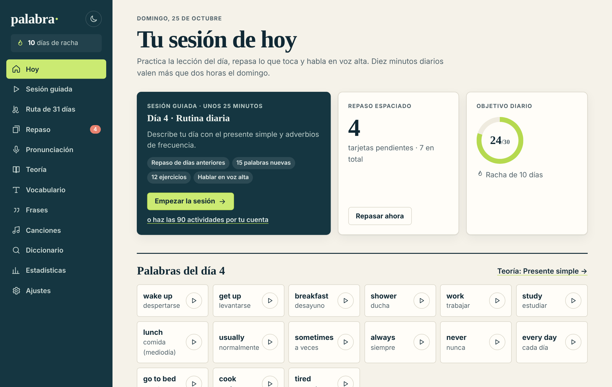
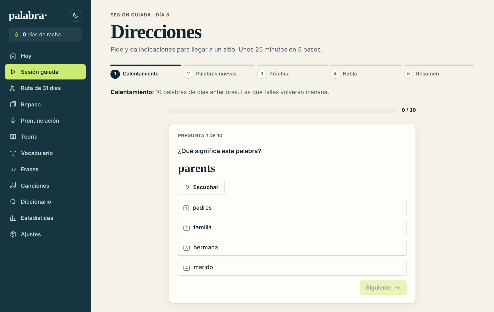
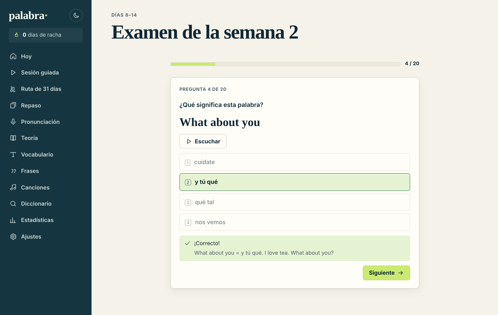
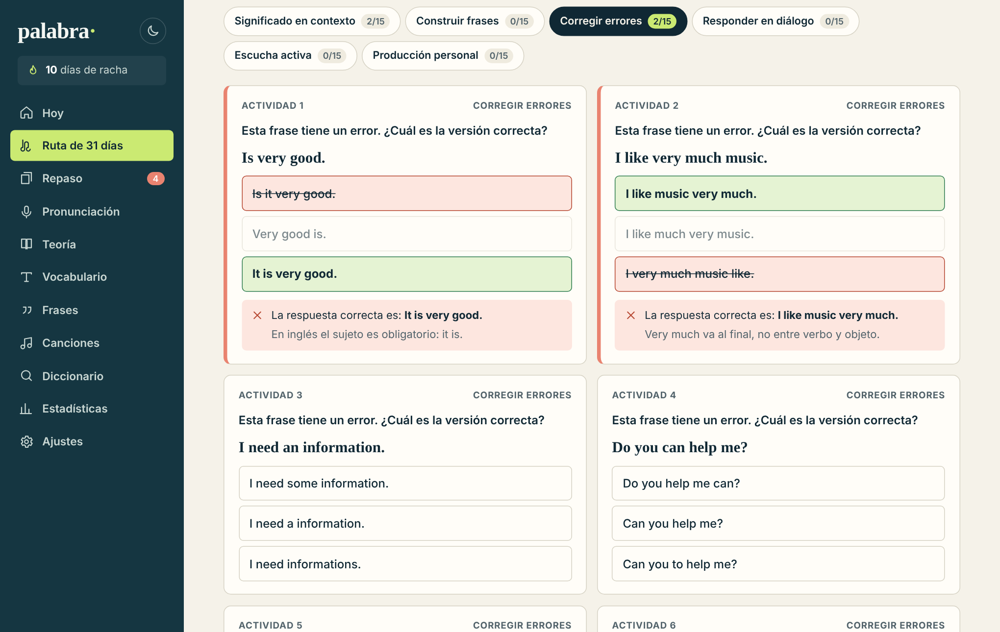
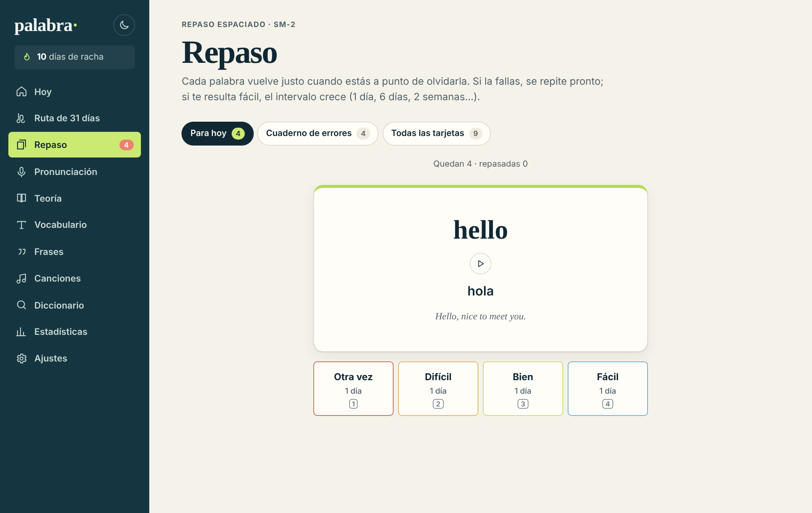
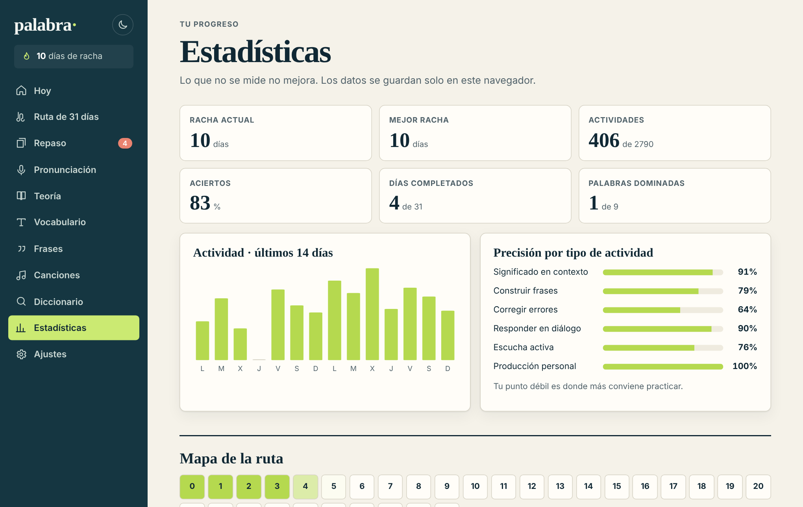
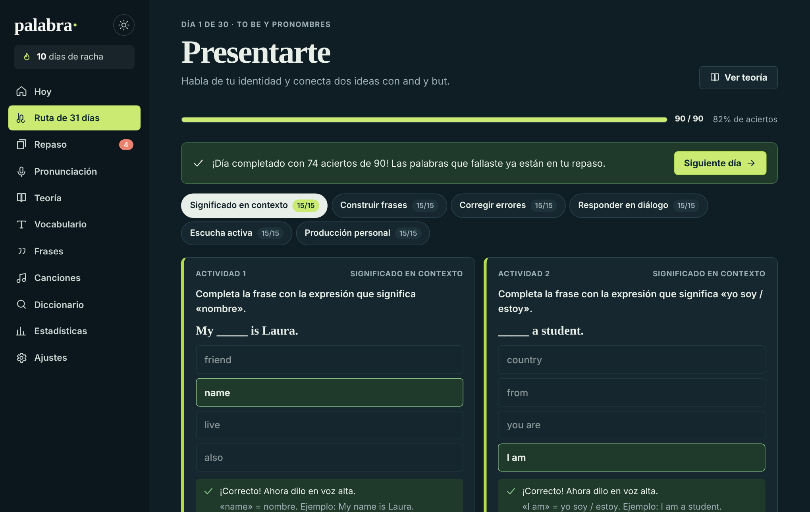
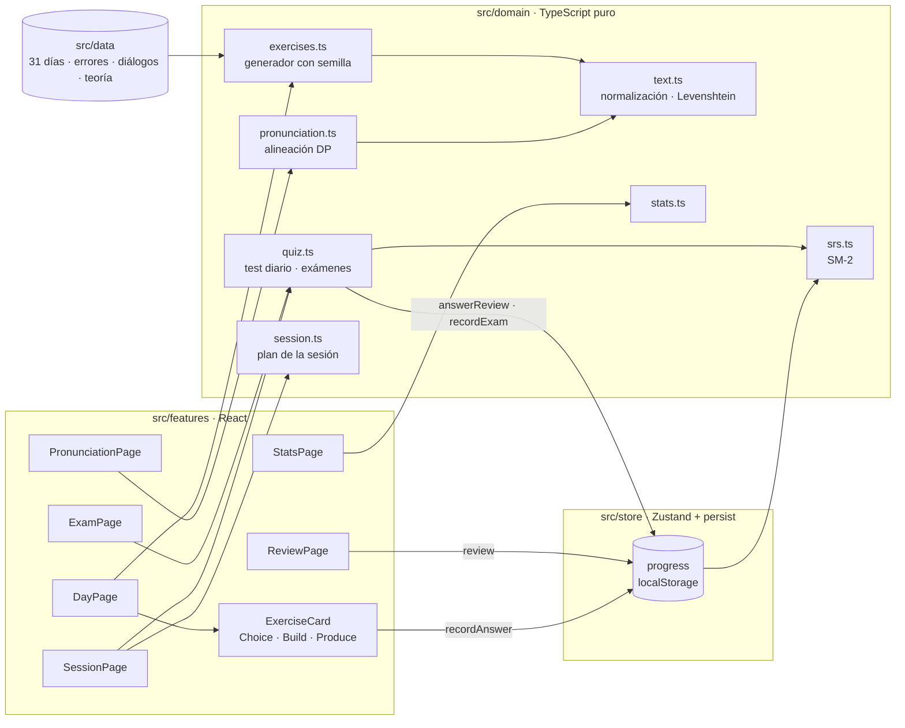

<div align="center">

# palabra<span>·</span>

**Aprende inglés en 31 días: práctica diaria, repaso espaciado y pronunciación con reconocimiento de voz.**

[](https://github.com/TU_USUARIO/palabra/actions/workflows/ci.yml)
[](https://github.com/TU_USUARIO/palabra/actions/workflows/deploy.yml)


[**Ver demo**](https://TU_USUARIO.github.io/palabra/) · [Funcionalidades](#funcionalidades) · [Arquitectura](#arquitectura) · [Decisiones técnicas](#decisiones-técnicas) · [Ejecutar en local](#ejecutar-en-local)



</div>

## Qué es

Palabra es una aplicación web (PWA) para hispanohablantes que empiezan con el inglés. Propone una ruta de **31 días × 90 actividades** que va del saludo a una conversación de tres minutos. Combina tres ideas con respaldo en la investigación sobre aprendizaje de idiomas:

1. **Práctica de recuperación**: seis tipos de ejercicio que obligan a producir, no solo a reconocer.
2. **Repaso espaciado**: cada palabra trabajada entra en un mazo que se programa con el algoritmo **SM-2**.
3. **Producción oral**: el reconocimiento de voz compara palabra a palabra lo que dices con la frase modelo.

**Cómo se usa en 30 días:** una sesión guiada al día de unos 25 minutos (repaso, palabras nuevas, ejercicios y hablar en voz alta) y un examen al final de cada semana. Las 90 actividades de cada día quedan como práctica extra.

Funciona sin servidor y sin registro: el progreso se guarda en el navegador y se puede exportar o importar en JSON.

## Funcionalidades

|                                   |                                                                                                                                                                                                                                                                  |
| --------------------------------- | ---------------------------------------------------------------------------------------------------------------------------------------------------------------------------------------------------------------------------------------------------------------- |
| **Sesión guiada diaria**          | Un solo botón encadena 5 pasos en unos 25 minutos: calentamiento (test de repaso), 15 palabras nuevas, 12 ejercicios (2 de cada tipo, priorizando los no hechos), 3 frases para decir en voz alta y un resumen. Al completarla, la ruta avanza al día siguiente. |
| **Test diario de repaso**         | 10 preguntas con vocabulario de días anteriores (inglés→español, español→inglés y escucha). Prioriza las tarjetas que vencen y las falladas, evita repetir lo ya repasado hoy y cada respuesta actualiza el SM-2.                                                |
| **Exámenes semanales**            | Después de los días 7, 14, 21 y 30: 20 preguntas nuevas en cada intento (vocabulario, gramática, comprensión oral y comunicación). Nota, aprobado con un 70 %, desglose por habilidad, y las palabras falladas pasan al repaso.                                  |
| **Ruta de 31 días**               | 15 conceptos nuevos al día (465 en total), cada uno con su frase de ejemplo, y 6 tipos de actividad: significado en contexto, construir frases, corregir errores, responder en diálogo, escucha activa y producción libre.                                       |
| **Repaso espaciado (SM-2)**       | Lo que fallas vuelve hoy; lo que aciertas, cuando estás a punto de olvidarlo. Tarjetas con atajos de teclado (`Espacio`, `1`–`4`) y vista previa del próximo intervalo.                                                                                          |
| **Pronunciación**                 | Web Speech API con alineación palabra a palabra (programación dinámica + Levenshtein) que marca qué palabras no se entendieron y da una puntuación.                                                                                                              |
| **Escucha con pares mínimos**     | Los distractores se diferencian en una sola palabra (_is/was_, _he/she_, _can/can't_…) para entrenar el oído de verdad.                                                                                                                                          |
| **Cuaderno de errores**           | Cada fallo se guarda con tu respuesta, la correcta y la explicación gramatical.                                                                                                                                                                                  |
| **Estadísticas**                  | Racha actual y récord, precisión por tipo de actividad, actividad de los últimos 14 días y mapa de la ruta.                                                                                                                                                      |
| **Teoría A0 → B1**                | Manual integrado; cada día enlaza con su sección.                                                                                                                                                                                                                |
| **Vocabulario y frases**          | Unos 700 conceptos con buscador y 1.200 frases en tres niveles, con audio y botón para añadirlos al repaso.                                                                                                                                                      |
| **Laboratorio de canciones**      | Pegas un fragmento y se marcan pronombres, verbos, conectores y contracciones, y se detecta el estribillo.                                                                                                                                                       |
| **Diccionario y ejemplos reales** | Free Dictionary API (definición, fonética y audio nativo) y Tatoeba (frases reales con traducción).                                                                                                                                                              |
| **PWA**                           | Instalable y usable sin conexión (excepto diccionario y reconocimiento de voz). Modo oscuro, diseño responsive y accesible con teclado.                                                                                                                          |

<table>
  <tr>
    <td></td>
    <td></td>
  </tr>
  <tr>
    <td></td>
    <td></td>
  </tr>
  <tr>
    <td></td>
    <td></td>
  </tr>
</table>

## Arquitectura



```text
src/
├── domain/      Lógica de negocio pura (sin React ni DOM) y testeada al ~98 %
├── data/        Contenido didáctico tipado: 31 días, 48 errores, 45 diálogos, teoría…
├── store/       Estado global (Zustand) con persistencia, migración por versión y backup JSON
├── features/    Una carpeta por pantalla (home, day, review, pronunciation, stats…)
├── components/  Componentes reutilizables (Layout, Icon, BarChart, SpeakButton…)
├── hooks/       Integraciones con el navegador: síntesis y reconocimiento de voz, tema
└── styles/      Sistema visual con tokens CSS (claro/oscuro)
```

La regla principal es que **el dominio no conoce React**. Los componentes solo orquestan: llaman a funciones puras (`generateDay`, `reviewCard`, `scorePronunciation`…) y guardan el resultado en el store. Por eso la lógica se testea sin montar componentes y se podría reutilizar tal cual en un backend.

## Decisiones técnicas

- **Generación determinista de ejercicios.** `generateDay` usa un PRNG con semilla (mulberry32 + hash FNV-1a del día). El mismo día genera siempre los mismos ejercicios, así que el progreso se guarda solo por `id` sin persistir los ejercicios, y los tests son reproducibles.
- **SM-2 con fechas locales.** Las fechas se guardan como `YYYY-MM-DD` en hora local para evitar errores de zona horaria (un repaso hecho a las 00:30 no debe contar como el día anterior). Incluye una pequeña variante de Anki: una tarjeta nueva marcada como "fácil" salta directamente a 4 días.
- **Corrección tolerante.** Las respuestas se normalizan (mayúsculas, apóstrofos tipográficos, puntuación) y la producción libre acepta flexiones regulares (_live → lived, study → studied_). Así se corrigió el bug de la versión anterior en el que las frases interrogativas nunca se podían acertar.
- **Pronunciación por alineación, no por igualdad.** Se calcula la subsecuencia común más larga entre palabras con coincidencia aproximada (Levenshtein ≤ 1 en palabras largas), para que un fallo del reconocedor en _station/stations_ no penalice. Las palabras de más restan medio punto para no premiar hablar sin parar.
- **Contenido como datos validados por tests.** `data.test.ts` comprueba que hay 31 días con 15 conceptos distintos, que cada frase de ejemplo contiene su concepto, que ningún día repite el vocabulario de otro y que ninguna pregunta tiene opciones duplicadas.
- **Sin `innerHTML`.** La teoría usa un mini-marcado (`**negrita**`, `*cursiva*`) que se convierte en nodos de React, sin riesgo de XSS.
- **Rendimiento.** Cada pantalla se carga bajo demanda con `React.lazy` y los ejercicios de cada día se memorizan. El bundle inicial pesa unos 95 kB en gzip.
- **Tests y exámenes deterministas.** El test diario usa como semilla la fecha y los exámenes el número de intento: el mismo test es reproducible (útil para depurar y testear), pero cada día y cada intento traen preguntas distintas.
- **Migraciones del estado guardado.** El store está versionado (`STORE_VERSION`) y `migrateProgress` actualiza los datos antiguos sin perder el progreso. Está cubierto por tests.
- **HashRouter** para que el despliegue en GitHub Pages funcione sin configurar el servidor.
- **Accesibilidad.** HTML semántico, roles ARIA en pestañas y feedback, `lang="en"` en el texto inglés (los lectores de pantalla lo pronuncian bien), foco visible, enlace para saltar al contenido, `prefers-reduced-motion` y linting con `eslint-plugin-jsx-a11y`.

## Calidad

```bash
npm test            # 140 tests (Vitest + Testing Library)
npm run coverage    # ~98 % de líneas en src/domain
npm run lint        # ESLint (typescript-eslint, react-hooks, jsx-a11y)
npm run typecheck   # TypeScript estricto con noUncheckedIndexedAccess
```

La integración continua ejecuta formato, lint, tipos, tests con cobertura y build en cada push y pull request. Cada push a `main` despliega automáticamente en GitHub Pages.

## Ejecutar en local

Requisitos: Node.js 20 o superior.

```bash
git clone https://github.com/TU_USUARIO/palabra.git
cd palabra
npm install
npm run dev        # http://localhost:5173
```

> El reconocimiento de voz funciona en Chrome, Edge y Safari. En Firefox la página de pronunciación ofrece el modo de escucha y repetición.

## Despliegue

1. Sube el repositorio a GitHub con el nombre `palabra`.
2. En **Settings → Pages**, elige **Source: GitHub Actions**.
3. El workflow `deploy.yml` publica la app en `https://TU_USUARIO.github.io/palabra/` en cada push a `main`.

## Qué cambió respecto a la primera versión

La versión inicial era HTML, CSS y JavaScript minificados en una sola línea por archivo. La reescritura:

- Corrige que **25 de los 31 días tenían el mismo vocabulario**: ahora hay 465 conceptos propios.
- Corrige que las frases interrogativas de "Construir frases" **eran imposibles de acertar**, y añade deshacer.
- Corrige que en "Escucha activa" las tres opciones **podían ser idénticas**: ahora se usan pares mínimos.
- Sustituye distractores triviales por errores plausibles escritos a mano.
- Añade la persistencia del progreso (antes se perdía al recargar), el repaso espaciado, la pronunciación, las estadísticas, la PWA, el modo oscuro, los tests y el CI/CD.
- Añade la sesión guiada diaria, el test de repaso de días anteriores y los exámenes semanales, para que el plan de 30 días sea fácil de seguir. El progreso guardado se migra solo de la versión 1 a la 2.

## Hoja de ruta

- [ ] Backend opcional (Spring Boot + PostgreSQL) para sincronizar el progreso entre dispositivos.
- [ ] Corrección de textos libres con un modelo de lenguaje.
- [ ] Tests end-to-end con Playwright.

## Créditos

- Algoritmo SM-2: Piotr Woźniak, _SuperMemo_ (1987).
- [Free Dictionary API](https://dictionaryapi.dev/) y [Tatoeba](https://tatoeba.org/) (CC BY 2.0 FR).
- Diseño, contenido didáctico y desarrollo: **Giuliana Castillo**.

Licencia [MIT](LICENSE).
